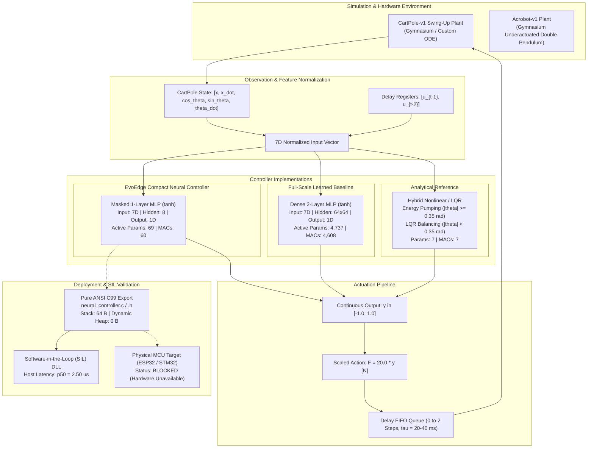
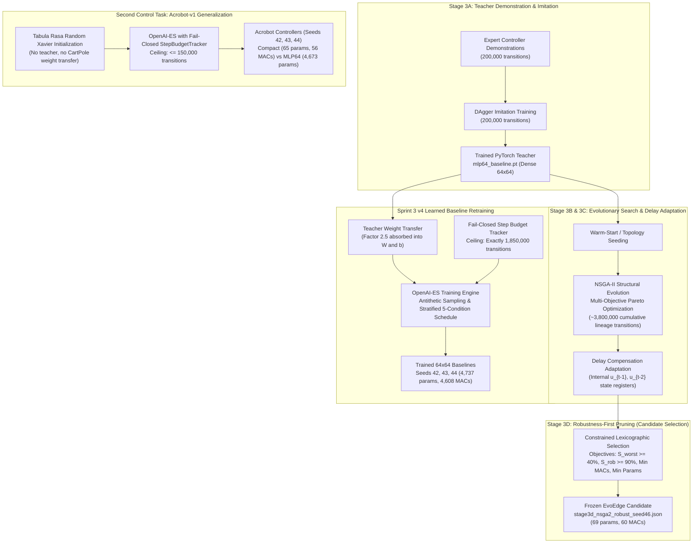
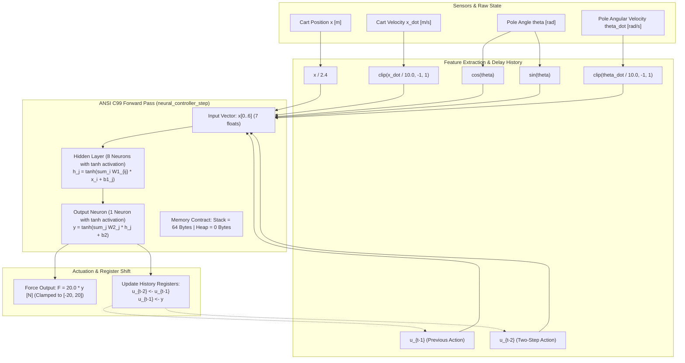

# EvoEdge System Architecture & Technical Design

**Document Classification:** Technical Architecture Specification  
**Primary Repository:** `D:\neat`  
**Target Environments:** CartPole Swing-Up (`CartPoleSwingUpEnv`), Gymnasium `Acrobot-v1`  
**Deployment Target:** ANSI C99 Portable Library (`neural_controller.c` / `hybrid_controller.c`)

---

## 1. High-Level System Architecture

EvoEdge is an end-to-end framework for synthesizing, compressing, verifying, and deploying ultra-compact neural and hybrid controllers for nonlinear dynamical systems under strict edge computing constraints ($\le 128$ parameters, $\le 128$ multiply-accumulate operations (MACs), zero dynamic heap memory allocation, and deterministic latency $\le 20\text{ ms}$).

The framework decouples physical plant simulation, feature extraction, evolutionary optimization, controller representation, and embedded deployment:

---

## 2. CartPole Environment and Observation Pipeline

### 2.1 Mechanical Plant Dynamics
The primary benchmark is the **CartPole Swing-Up and Stabilization** problem (`env/cartpole_swingup.py`):
- **Cart Mass ($M_c$):** $1.0\text{ kg}$ (nominal; perturbed up to $1.30\text{ kg}$)
- **Pole Mass ($m_p$):** $0.1\text{ kg}$ (nominal; perturbed up to $0.13\text{ kg}$)
- **Pole Half-Length ($l$):** $0.5\text{ m}$ (total length $1.0\text{ m}$)
- **Rail Bounds:** Cart displacement must remain within $|x| < 2.4\text{ m}$. Any excursion beyond $\pm 2.4\text{ m}$ triggers an instant episode failure.
- **Initial State:** The pole begins hanging straight downwards ($\theta = \pi\text{ rad}$) with zero angular and linear velocities ($\dot\theta = 0, \dot{x} = 0, x = 0$).

### 2.2 Feature Normalization and Delay Registers
Controllers observe a continuous 7-dimensional normalized vector $\mathbf{x}_t \in \mathbb{R}^7$:
$$\mathbf{x}_t = \left[ \frac{x_t}{2.4},\, \text{clip}\left(\frac{\dot{x}_t}{10.0}, -1, 1\right),\, \cos\theta_t,\, \sin\theta_t,\, \text{clip}\left(\frac{\dot{\theta}_t}{10.0}, -1, 1\right),\, u_{t-1},\, u_{t-2} \right]$$

1. **Trigonometric Decomposition:** Continuous $\cos\theta$ and $\sin\theta$ eliminate phase-wrap branch discontinuities around $\pm\pi$, avoiding catastrophic gradient/evolutionary instability.
2. **Delay-Aware Memory Registers:** $u_{t-1}$ and $u_{t-2}$ represent the controller's own outputs from the previous two timesteps ($t-1$ and $t-2$). This internal state memory enables compensation for up to 2 steps ($40\text{ ms}$) of transport latency without requiring a recurrent neural network (RNN).

---

## 3. Controller Architectures & Complexity

| Controller | Architecture Type | Hidden Layers | Active Parameters | Weight MACs | Memory (Heap / Stack) |
| :--- | :--- | :---: | :---: | :---: | :---: |
| **EvoEdge Candidate (`stage3d_nsga2_robust_seed46`)** | Masked MLP | 1 layer ($H=8$) | **69** | **60** | **0 B / 64 B** |
| **OpenAI-ES Baseline (`v4_seed42/43/44`)** | Dense MLP | 2 layers ($64 \times 64$) | **4,737** | **4,608** | **0 B / ~1 KB** |
| **Classical Reference (`HybridController`)** | Piecewise Energy/LQR | N/A (Analytical) | **7** | **7** | **0 B / 32 B** |

### Mathematical Formulation of the Compact Candidate
For an input vector $\mathbf{x} \in \mathbb{R}^7$:
$$\mathbf{h} = \tanh\left( \mathbf{M}_1 \odot (\mathbf{W}_1 \mathbf{x} + \mathbf{b}_1) \right) \in \mathbb{R}^8$$
$$y = \tanh\left( \mathbf{m}_2 \odot (\mathbf{W}_2 \mathbf{h} + b_2) \right) \in [-1.0, 1.0]$$
$$\text{Force } F = 20.0 \cdot y \quad [\text{N}]$$

Where $\mathbf{M}_1 \in \{0, 1\}^{8 \times 7}$ and $\mathbf{m}_2 \in \{0, 1\}^8$ are binary structural masks evolved via NSGA-II to prune inactive synaptic connections.

---

## 4. Multi-Stage Optimization and Pruning Pipeline

EvoEdge uses a **teacher-assisted evolutionary compression pipeline** rather than discovering networks from scratch:

### Stage Breakdown:
1. **Stage 3A (Teacher Pretraining):** A 64×64 dense MLP teacher (`results/mlp64_baseline.pt`) was trained via DAgger on 200,000 transitions of expert classical control demonstrations.
2. **Stage 3B (Structural Evolution):** Topology-evolving NSGA-II pruned redundant hidden neurons and connections while optimizing nominal reward.
3. **Stage 3C (Delay Adaptation):** Delay registers ($u_{t-1}, u_{t-2}$) were integrated into the genome state, evolving weights capable of stabilizing the cart under 20–40 ms actuator transport latency.
4. **Stage 3D (Robustness-First Selection):** Evolved candidates under domain randomization across 8 physical conditions. Champion selection enforced **constrained lexicographic dominance**:
   - Primary: Feasibility filter ($\text{robust\_success} > 0$).
   - Secondary: Worst-condition success rate ($S_{\text{worst}} \ge 40\%$).
   - Tertiary: Aggregate robust success ($\bar{S}_{\text{rob}} \ge 90\%$).
   - Quaternary: Minimal active parameters ($P \le 128$) and MACs ($M \le 128$).
   - **Champion:** Seed 46 (`stage3d_nsga2_robust_seed46.json`), achieving 90.0% worst-condition success, 98.0% aggregate robust success, 69 active parameters, and 60 weight MACs.

---

## 5. Embedded C Export & Execution Pipeline

The frozen Python candidate is transpiled to pure ANSI C99 (`results/deployment/neural_controller.c` and `neural_controller.h`):

### Key Embedded Contracts:
1. **Zero Dynamic Allocation:** No calls to `malloc`, `free`, or runtime heap managers.
2. **Static Bounded Stack:** Exactly 64 bytes of stack space required for local activation buffers.
3. **Deterministic Numerical Parity:** Max action discrepancy between the Python reference and native compiled C99 library is **$< 1.25 \times 10^{-6}$** across 50,000 closed-loop steps.
4. **Desktop Host Latency:** Median execution time of **$2.50\ \mu\text{s}$** measured via OS high-resolution timers on an x86_64 host (0.0125% of a 50 Hz control period).
5. **Hardware Scope Limitation:** Actual physical MCU execution (ESP32/STM32) has not been measured; physical deployment remains an open gate.

---

## 6. Cryptographic Artifact Integrity Ledger

Every published architecture specification, model checkpoint, and evaluation report maps to exact raw file bytes:

| Artifact Description | Canonical File Path | Size (Bytes) | Exact SHA-256 Digest |
| :--- | :--- | :---: | :--- |
| **Frozen CartPole Candidate** | `results/stage3d/models/stage3d_nsga2_robust_seed46.json` | 4,076 | `0C9A57692131972D52F75BD633A64BAE2A34A7B4EC2FB94C56041065C58A2B0E` |
| **DAgger Teacher Weights** | `results/mlp64_baseline.pt` | 21,070 | `2CD704F0064171190DAAC270DE317A37FCDF8A55CB884DA6EDB6DC744F409842` |
| **v4 Learned Baseline Seed 42** | `work/phase3e_followup_6h/sprint3/project_closeout/v4_baseline/checkpoints/baseline_teacher_init_seed42.json` | 134,705 | `B86C454CD82404FA88C00B5B11B8BF7A9CF50608F7969EAE289356396FFDCEB3` |
| **v4 Learned Baseline Seed 43** | `work/phase3e_followup_6h/sprint3/project_closeout/v4_baseline/checkpoints/baseline_teacher_init_seed43.json` | 134,699 | `4B8D149B9057EE5169EBD4F7250DE1DE867E2596BA9CD757E4EB2DF82EE8ECBC` |
| **v4 Learned Baseline Seed 44** | `work/phase3e_followup_6h/sprint3/project_closeout/v4_baseline/checkpoints/baseline_teacher_init_seed44.json` | 134,710 | `6AE128BE1176BF39FBF51D0455B771F5BC4AE6D6497B0ECF9B5BFEC282A81180` |
| **Acrobot Compact Seed 44 v2** | `work/phase3e_followup_6h/sprint3/research_upgrade/second_task/checkpoints/acrobot_compact_seed44.json` | 2,162 | `DB282929979BB141C06A5FDFECEBF1B237CF399434D45115EB0B8904857E9387` |
| **Acrobot MLP64 Seed 43 v2** | `work/phase3e_followup_6h/sprint3/research_upgrade/second_task/checkpoints/acrobot_mlp64_seed43.json` | 124,157 | `7F3A66F14178AA466C17F2587DF9523CFD867E19E2CA4ECCC83D732510A3A83B` |
| **ANSI C99 Export Source** | `results/deployment/neural_controller.c` | 3,923 | `21B21ACF0C962888D79EEB1DE2DFFC62F8A437C0E4BFA069502C66A96E7C418F` |
| **CartPole Raw Telemetry CSV** | `work/phase3e_followup_6h/sprint3/project_closeout/v4_baseline/reports/paired_episodes.csv` | 50,079 | `9944CDD92C451D447833C1488B27357F2DC0CD28B8413284B9F11394B1B85D83` |
| **Acrobot Raw Telemetry CSV** | `work/phase3e_followup_6h/sprint3/research_upgrade/second_task/results/acrobot_episodes_v2.csv` | 163,269 | `423DBAD6A86D497313DCFF2942990B6FDBD27A694480BA98E3410956AA0A2638` |
