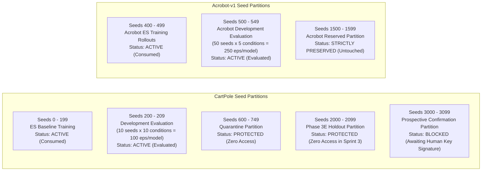

# EvoEdge Experimental Methodology & Optimization Protocols

**Document Classification:** Scientific Methodology Specification
**Repository:** [`opensourcecodedesigner/EvoEdge`](https://github.com/opensourcecodedesigner/EvoEdge)
**Environments:** CartPole Swing-Up (`CartPoleSwingUpEnv`), Gymnasium `Acrobot-v1`
**Governing Documents:** Protocol v1.8 (`comparison_preregistration.md`), Acrobot Protocol v1.1 (`PROTOCOL.md`)

---

## 1. Controller Architecture & Signal Representations

### 1.1 Input Features & Dynamic Delay Registers
The controller accepts a 7-dimensional normalized feature vector $\mathbf{x}_t \in \mathbb{R}^7$:
$$\mathbf{x}_t = \left[ \frac{x_t}{2.4},\, \operatorname{clip}\left(\frac{\dot{x}_t}{10.0}, -1, 1\right),\, \cos\theta_t,\, \sin\theta_t,\, \operatorname{clip}\left(\frac{\dot{\theta}_t}{10.0}, -1, 1\right),\, u_{t-1},\, u_{t-2} \right]$$

- **Position Normalization:** $x_t / 2.4$ maps the track limits $[-2.4\text{ m}, +2.4\text{ m}]$ linearly to $[-1.0, 1.0]$.
- **Velocity Clamping:** Cart velocity $\dot{x}_t$ and angular velocity $\dot{\theta}_t$ are divided by $10.0$ and clamped to $[-1.0, 1.0]$, preventing extreme transient velocity outliers from saturating the input layer.
- **Continuous Trigonometric State:** Angle $\theta_t$ is encoded via $[\cos\theta_t, \sin\theta_t]$. This eliminates the $[- \pi, +\pi]$ branch cut singularity, ensuring $C^\infty$ smooth state representations across full $360^\circ$ swings.
- **Delay Registers:** $u_{t-1}$ and $u_{t-2}$ are internal state registers storing the control signals computed at steps $t-1$ and $t-2$. When actuator transport latency is introduced (1-step $\tau = 20\text{ ms}$ or 2-step $\tau = 40\text{ ms}$), the physical plant executes delayed force $F_t = 20.0 \cdot u_{t - \text{delay}}$. The presence of $u_{t-1}$ and $u_{t-2}$ in the state space allows the feedforward controller to perform state prediction (Smith-predictor analogue) without dynamic recurrent cells.

### 1.2 Action Mapping & Saturation
The output layer produces a scalar $y_t = \tanh(\cdot) \in [-1.0, 1.0]$. The physical force applied to the cart is:
$$F_t = 20.0 \cdot y_t \quad [\text{N}]$$
Actuator saturation is strictly bounded to $\pm 20.0\text{ N}$.

---

## 2. Multi-Stage Optimization Pipeline & Teacher Provenance

### 2.1 The Teacher-Assisted Compression Paradigm
EvoEdge is **not** an autonomous from-scratch neuroevolutionary discovery system. Evolving neural swing-up controllers tabula rasa under sparse terminal balance constraints frequently leads to deceptive local optima (e.g., pumping back and forth or holding the pole horizontal).

To solve this, EvoEdge uses a **teacher-assisted compression and robustification pipeline**:
1. **Teacher Generation:** An expert classical controller generates 200,000 transitions of state-action demonstrations.
2. **DAgger Imitation Pretraining:** A 64×64 dense MLP is trained via Dataset Aggregation (DAgger) on 200,000 interactive transitions (`results/mlp64_baseline.pt`).
3. **Evolutionary Pruning (NSGA-II):** Non-dominated Sorting Genetic Algorithm II prunes redundant connections and neurons from the teacher manifold, optimizing Pareto frontiers of performance vs. active parameters vs. MACs.
4. **Delay & Disturbance Hardening:** The pruned genome undergoes domain-randomized evolutionary search across 8 physical conditions.

### 2.2 Evolutionary Search Algorithm (NSGA-II)
- **Population Size:** 32 candidate genomes.
- **Genome Encoding (`MaskedGenome`):** A fixed base architecture (7 inputs, 8 hidden neurons, 1 output) with binary connection masks $\mathbf{M} \in \{0, 1\}$ and continuous weight vectors $\mathbf{w} \in \mathbb{R}^{65}$.
- **Genetic Operators:**
  - Connection mutation rate: $p_{\text{mask}} = 0.05$ (stochastic bit-flip).
  - Weight mutation: Gaussian perturbation $\Delta w \sim \mathcal{N}(0, 0.02^2)$.
  - Crossover: Uniform parameter crossover across unmasked edges.

---

## 3. Training Reward vs. Official Success Predicate

A fundamental methodological principle in EvoEdge is the strict separation between the **continuous training reward** and the **frozen binary qualification predicate**:

### 3.1 Official Binary Success Predicate
An evaluation episode is classified as a **SUCCESS** if and only if both criteria are met:
1. **No Rail Collision:** $|x_t| < 2.4\text{ m}$ for all $t \in [1, 500]$.
2. **Terminal Inverted Dwell:** The pole remains upright and nearly stationary for at least 95 of the final 100 timesteps:
   $$\sum_{t=401}^{500} \mathbb{I}\left( \cos\theta_t > 0.90 \;\land\; |\dot{\theta}_t| < 2.0\text{ rad/s} \right) \ge 95$$

### 3.2 Stage 3B/v4 Step Reward Formulation
During evolutionary search and baseline ES training, policies optimize a dense reward designed to prevent reward deception:
$$r_t = r_{\text{track}} + r_{\text{upright}} + r_{\text{dwell}} + r_{\text{effort}}$$
- $r_{\text{track}} = 1.0 - (x_t / 2.4)^2$ (encourages centering).
- $r_{\text{upright}} = \cos\theta_t$ (encourages vertical alignment).
- $r_{\text{dwell}} = +4.0$ if $t > 400 \;\land\; \cos\theta_t > 0.90$; $-2.0$ if $t > 400 \;\land\; \cos\theta_t < 0.50$.
- $r_{\text{effort}} = -0.01 \cdot u_t^2$ (penalizes actuator chatter).
- **Rail Crash Penalty:** If $|x_t| \ge 2.4\text{ m}$, the episode terminates immediately with a penalty of $-100.0$.

---

## 4. Registered Physical Perturbation Matrix

Controllers are evaluated across a preregistered suite of 10 physical diagnostic conditions on CartPole (`utils/perturbation_loader.py`):

| Condition ID | Name | Cart Mass $M_c$ | Pole Mass $m_p$ | Cart Friction $b_c$ | Joint Friction $b_p$ | Sensor Noise $\sigma$ | Transport Delay $\tau$ |
| :---: | :--- | :---: | :---: | :---: | :---: | :---: | :---: |
| **1** | **Nominal** | $1.00\text{ kg}$ | $0.10\text{ kg}$ | $0.00$ | $0.00$ | $0.00$ | $0\text{ ms}$ (0 steps) |
| **2** | **Pole Mass +30%** | $1.00\text{ kg}$ | $\mathbf{0.13\text{ kg}}$ | $0.00$ | $0.00$ | $0.00$ | $0\text{ ms}$ (0 steps) |
| **3** | **Cart Mass +30%** | $\mathbf{1.30\text{ kg}}$ | $0.10\text{ kg}$ | $0.00$ | $0.00$ | $0.00$ | $0\text{ ms}$ (0 steps) |
| **4a** | **Cart Friction 0.50** | $1.00\text{ kg}$ | $0.10\text{ kg}$ | $\mathbf{0.50\text{ N}\cdot\text{s/m}}$ | $0.00$ | $0.00$ | $0\text{ ms}$ (0 steps) |
| **4b** | **Joint Friction 0.010** | $1.00\text{ kg}$ | $0.10\text{ kg}$ | $0.00$ | $\mathbf{0.010\text{ N}\cdot\text{m}\cdot\text{s/rad}}$ | $0.00$ | $0\text{ ms}$ (0 steps) |
| **4c** | **Combined Friction** | $1.00\text{ kg}$ | $0.10\text{ kg}$ | $\mathbf{0.50\text{ N}\cdot\text{s/m}}$ | $\mathbf{0.010\text{ N}\cdot\text{m}\cdot\text{s/rad}}$ | $0.00$ | $0\text{ ms}$ (0 steps) |
| **5** | **Sensor Noise 0.05** | $1.00\text{ kg}$ | $0.10\text{ kg}$ | $0.00$ | $0.00$ | $\mathbf{\sigma = 0.05}$ | $0\text{ ms}$ (0 steps) |
| **6a** | **Actuator Delay 1-Step** | $1.00\text{ kg}$ | $0.10\text{ kg}$ | $0.00$ | $0.00$ | $0.00$ | $\mathbf{20\text{ ms}\text{ (1 step)}}$ |
| **6b** | **Actuator Delay 2-Step** | $1.00\text{ kg}$ | $0.10\text{ kg}$ | $0.00$ | $0.00$ | $0.00$ | $\mathbf{40\text{ ms}\text{ (2 steps)}}$ |
| **7** | **Combined Stress** | $\mathbf{1.30\text{ kg}}$ | $\mathbf{0.13\text{ kg}}$ | $\mathbf{0.30\text{ N}\cdot\text{s/m}}$ | $\mathbf{0.005\text{ N}\cdot\text{m}\cdot\text{s/rad}}$ | $\mathbf{\sigma = 0.03}$ | $\mathbf{40\text{ ms}\text{ (2 steps)}}$ |

---

## 5. Seed Partition Governance & Isolation

To eliminate data leakage, seed allocation is partitioned into disjoint namespaces:

### Partition Access Rules:
- **Training Rollout Seeds (`0–199`):** Reserved exclusively for environment initializations during ES baseline training.
- **Development Evaluation Seeds (`200–209`):** 10 evaluation seeds evaluated across 10 conditions = 100 episodes per model. Used for paired comparisons and defect resolution audits.
- **Quarantine Seeds (`600–749`):** Quarantined following early exploratory leakage in Sprint 2; strictly forbidden from all subsequent training and evaluation.
- **Phase 3E Holdout Seeds (`2000–2099`):** Used strictly for the historical Phase 3E confirmation; zero access permitted during baseline retraining.
- **Prospective Confirmation Seeds (`3000–3099`):** Strictly blocked until a valid, human-signed cryptographic authorization token is verified.
- **Acrobot Reserved Partition (`1500–1599`):** Reserved untouched partition for prospective double-pendulum validation.

---

## 6. Transition-Budget Accounting & Fail-Closed Enforcement

### 6.1 Transition vs. Lineage Disaggregation
- **Search Budget Parity:** Both the EvoEdge candidate search (Phase 3D) and the OpenAI-ES baseline training runs operated under a pre-registered **1,850,000 search transition ceiling**.
- **Cumulative Lineage Discrepancy:** The EvoEdge candidate lineage spans approximately 6.2M cumulative transitions across historical refinement phases (3A $\to$ 3B $\to$ 3C $\to$ 3D). The baseline consumed 2.25M transitions (400k teacher pretraining + 1.85M ES search). Claims of budget parity apply strictly to the final-stage search procedure, not the multi-stage lineage.

### 6.2 Fail-Closed Transition Accounting Rule
In both CartPole (`train_v4_baseline.py`) and Acrobot (`train_acrobot_v2.py`), transition accounting is enforced at the step level:
- A global transition counter increments *before every physical simulator transition*.
- If the remaining transition allowance is insufficient to support an entire generation ($P$ candidates $\times K$ rollouts), the training loop terminates cleanly at or below the hard ceiling.
- Training updates never execute on truncated or incomplete candidate batches.

---

## 7. Statistical Evaluation Methods

### 7.1 Wilson Score Confidence Intervals
For individual controller success rates $p = k / N$, two-sided 95% Wilson Score intervals are computed without normal approximation assumptions:
$$\text{CI}_{95\%} = \frac{p + \frac{z^2}{2N} \pm z \sqrt{\frac{p(1-p)}{N} + \frac{z^2}{4N^2}}}{1 + \frac{z^2}{N}}, \quad z = 1.95996$$

### 7.2 Clustered Bootstrap Resampling
Because evaluation evaluates the same set of evaluation seeds across multiple perturbation conditions, observations within the same seed are statistically dependent. To compute confidence intervals for paired differences $\Delta = p_A - p_B$:
- Resampling is **clustered by evaluation seed** ($S=10$ clusters for CartPole; $S=50$ clusters for Acrobot).
- In each bootstrap iteration $b \in [1, B]$ ($B=1,000$), entire seed clusters (containing all 10 condition runs) are resampled with replacement.
- The 95% confidence interval is extracted via the percentile method $[\Delta_{0.025}^*, \Delta_{0.975}^*]$.
